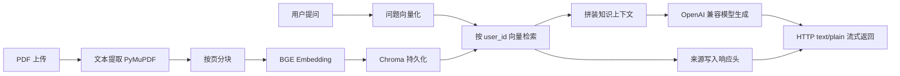

# AI 学习助手

面向学习场景的个人 AI 助手：支持登录后的多轮对话、PDF 知识库入库，以及基于用户自有文档的检索增强问答（RAG）。前后端分离，数据默认落在本机 SQLite 与 Chroma 目录中。

## 当前已实现的功能

以下均有仓库内生产代码路径对应（见后文「功能说明」），**不含**仅存在于 `backend/experiments/` 的实验能力：

- JWT 登录与受保护页面 / API
- 会话创建、历史消息、HTTP 文本流式回复与 Markdown 展示
- PDF 上传、文本提取、分块、BGE 向量化、Chroma 持久化
- 按当前用户隔离的知识检索、上下文拼装、来源 / 引用展示
- 知识库文档列表与单文档总结（需登录）

**未作为生产能力提供：** Dense + BM25 + RRF 混合检索等（见 `backend/experiments/`，仅用于离线评测）。

## 技术栈

| 层级 | 技术（以代码与依赖为准） |
|------|--------------------------|
| 前端 | Vue 3、TypeScript、Vite、Pinia、Vue Router、Axios、Element Plus、markdown-it |
| 后端 | FastAPI、Uvicorn、Pydantic、python-dotenv |
| 认证 | JWT（`python-jose`，HS256）、密码 bcrypt |
| 业务库 | SQLite（`backend/database/ai_assistant.db`） |
| 大模型 | OpenAI 兼容 HTTP API（`openai` SDK，`AI_BASE_URL` / `AI_MODEL`） |
| RAG | PyMuPDF 抽文本、自研分块、`sentence-transformers`（`BAAI/bge-small-zh-v1.5`）、Chroma 持久化 |
| 上下文预算 | 本地 DeepSeek tokenizer 资源（`backend/tokenizer/`）+ `transformers` / `tokenizers` |

## 功能说明（代码依据）

| 能力 | 说明 | 主要位置 |
|------|------|----------|
| JWT 登录 | `/api/auth/login` 校验用户后签发 Bearer Token；受保护接口依赖 `get_current_user` | `backend/app/api/auth.py`、`core/security.py`、`api/dependencies.py` |
| PDF 上传与抽取 | 仅接受 PDF，限制大小，临时文件入库；`pymupdf` 按页抽文本 | `api/knowledge.py`、`rag/pdf_loader.py` |
| 分块与 Embedding | 按页切分后分块（默认 chunk≈500，overlap≈80）；BGE small 中文向量，`normalize_embeddings=True` | `rag/text_splitter.py`、`services/rag_ingestion_service.py` |
| Chroma 存储 | 本地目录 `backend/data/chroma_db`，collection `ai_learning_knowledge`，metadata 含 `user_id` / `source` / `page` 等 | `rag/vector_store.py` |
| 知识检索 | 问题向量化后按 `user_id`（可选再按文件名）过滤检索 | `services/rag_retrieval_service.py` |
| 上下文构建 | 检索块拼入提示；无结果时明确告知模型勿编造引用 | `services/chat_service.py`、`context_builder.py` |
| AI 对话与流式 | `POST /api/chat/stream` 返回 **`text/plain` HTTP 流**（**不是 SSE**）；前端 `fetch` + `ReadableStream` | `api/chat.py`、`services/ai_service.py`、`frontend/src/api/chat.ts` |
| 来源展示 | 响应头 `X-Knowledge-Citations` / `X-Knowledge-Status`（CORS `expose_headers` 已配置） | `api/chat.py`、`services/rag_citations.py`、`main.py` |
| 会话与隔离 | 会话/消息按 `user_id` 归属；知识入库与检索使用 JWT 中的用户 ID，不信任前端自报 user_id | `repositories/conversation_repository.py`、`api/knowledge.py`、`chat_service.py` |

前端路由（需登录：`/chat`、`/knowledge` 等）：`frontend/src/router/index.ts`。Axios 默认后端：`http://127.0.0.1:8000`（`frontend/src/utils/request.ts`）。

## 架构与目录

### RAG 主链路（生产）



### 目录作用

```
ai-assistant/
├── frontend/                 # Vue3 前端（Vite 默认端口 5173）
│   └── src/views/            # Login / Chat / Knowledge 等页面
├── backend/
│   ├── app/
│   │   ├── main.py           # FastAPI 入口；启动时 init_database()
│   │   ├── api/              # 路由：auth / chat / knowledge / conversations …
│   │   ├── services/         # 业务：聊天、RAG 入库/检索、引用、上下文
│   │   ├── rag/              # PDF、分块、向量库封装
│   │   ├── core/             # JWT、密码
│   │   └── repositories/     # SQLite 访问
│   ├── database/             # 本地 SQLite（勿提交公开仓库）
│   ├── data/chroma_db/       # Chroma 持久化（勿提交）
│   ├── tokenizer/            # 上下文 token 计数用本地 tokenizer
│   ├── experiments/          # 离线实验与评测（含 Hybrid RRF 等，非生产）
│   ├── .env.example          # 环境变量模板
│   └── requirements.txt
└── README.md                 # 本文件
```

## Windows 环境准备与启动

以下命令面向 **Windows CMD**。请在已安装 **Python 3** 与 **Node.js** 的前提下操作。
本仓库开发机曾使用 Python 3.14 + 本地 `backend/venv`；**其他 Python 小版本上的全新安装未在本阶段复测**，若依赖安装失败请记录版本后再排查。

### 1. 后端：虚拟环境与依赖

```bat
cd /d D:\project\ai-assistant\backend
python -m venv venv
venv\Scripts\activate.bat
python -m pip install -U pip
pip install -r requirements.txt
```

首次调用 Embedding 时会从 Hugging Face 拉取 `BAAI/bge-small-zh-v1.5`（需可用网络，耗时取决于带宽）。

### 2. 配置环境变量

```bat
cd /d D:\project\ai-assistant\backend
copy .env.example .env
notepad .env
```

至少填写：`AI_API_KEY`、`AI_BASE_URL`、`AI_MODEL`、`JWT_SECRET_KEY`（≥32 字符的随机串，禁止使用示例弱口令）。
若数据库中**尚不存在** `admin` 用户，还需设置 `ADMIN_INITIAL_PASSWORD`（强密码）；**已有 admin 时不要依赖该变量重置密码**（代码不会覆盖已有密码）。

生成随机 JWT 密钥示例（勿把输出贴到公开处）：

```bat
powershell -NoProfile -Command "[Convert]::ToBase64String((1..48 | ForEach-Object {Get-Random -Maximum 256}) -as [byte[]])"
```

将结果写入 `.env` 的 `JWT_SECRET_KEY=`。**不要提交 `.env`。**

### 3. 启动 FastAPI

请在 `backend` 目录、已激活 venv 的情况下启动（`main.py` 导入时会执行 `init_database()` 创建表，并尝试种子管理员；同时会校验 `JWT_SECRET_KEY`）：

```bat
cd /d D:\project\ai-assistant\backend
venv\Scripts\activate.bat
uvicorn app.main:app --reload --host 127.0.0.1 --port 8000
```

- API 根路径探测：`http://127.0.0.1:8000/`
- 交互文档（若开启）：`http://127.0.0.1:8000/docs`

CORS 允许来源：`http://localhost:5173`、`http://127.0.0.1:5173`（见 `app/main.py`）。

### 4. 前端：依赖与启动

另开一个 CMD：

```bat
cd /d D:\project\ai-assistant\frontend
npm install
npm run dev
```

浏览器打开 Vite 提示的地址（默认 **`http://127.0.0.1:5173`**）。前端请求后端默认 **`http://127.0.0.1:8000`**。

## 环境变量说明

| 变量 | 必填？ | 用途 | 占位示例（勿当生产值） |
|------|--------|------|------------------------|
| `AI_API_KEY` | 调用模型时需要 | OpenAI 兼容 API 密钥 | `sk-your-key-here` |
| `AI_BASE_URL` | 同上 | API Base URL | `https://api.example.com/v1` |
| `AI_MODEL` | 同上 | 模型名 | `your-model-name` |
| `JWT_SECRET_KEY` | **是（启动即校验）** | JWT 签名密钥；≥32 字符；拒绝常见占位串 | （自行生成的长随机串） |
| `ADMIN_INITIAL_PASSWORD` | 仅当库中还没有 `admin` | 首次创建管理员；已存在则忽略且不覆盖 | （自设强密码；勿用 `123456` 等） |

加载方式：`security.py` / `user_seed.py` 会从 **`backend/.env`** 加载；`ai_service.py` 也会 `load_dotenv()`。建议始终在 `backend` 目录启动，并保证 `.env` 位于该目录。

## 安全与隐私

- `.env`、SQLite、Chroma 数据、含个人信息的 PDF 属于**本地私密数据**，不应推送到公开 Git 仓库。
- 仓库已通过 `.gitignore` 忽略常见敏感路径；历史提交若曾包含上述文件，需自行评估清理（本 README 不提供强制历史改写步骤）。
- 公开文档与演示中不要粘贴真实 API Key、JWT 密钥或账号密码。

## 功能验证清单（手动）

以下为建议自测步骤；**本阶段文档工作未代替你执行这些步骤，不声称已经通过。**

1. **登录**：打开前端登录页，使用已有账号或首次创建的 admin 登录；未登录访问 `/chat` 应被重定向。
2. **普通聊天**：关闭知识库选项，发送消息，确认回复为逐步流出的文本（非一次性整段才出现）。
3. **PDF 上传**：进入知识库页上传可抽取文本的 PDF，确认返回成功且文档列表可见。
4. **知识库问答**：开启知识库（可指定文件名），提问文档内可回答的内容，确认回答合理。
5. **来源展示**：有检索命中时，界面应能展示来源文件/页码等信息（来自响应头解析，而非模型随意编造的文件名）。

## 实验目录说明

`backend/experiments/` 包含 RAG 评测、Hybrid（Dense + BM25 + RRF）等脚本与输出。它们**不接入**生产 `retrieve_knowledge` 路径，简历或演示中请区分「实验评估」与「线上检索」。

## 许可证与仓库

GitHub：<https://github.com/LMCat-Miao/ai-assistant>
