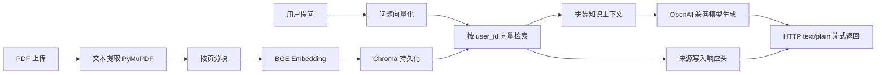

# AI 学习助手

面向学习场景的个人 AI 助手：支持登录后的多轮对话、PDF 知识库入库，以及基于用户自有文档的检索增强问答（RAG）。前后端分离；**业务数据（用户 / 会话 / 消息）存储在 MySQL 8.4**，**RAG 文档向量仍由本机 Chroma 独立持久化**。

## 当前已实现的功能

以下均有仓库内生产代码路径对应（见后文「功能说明」），**不含**仅存在于 `backend/experiments/` 的实验能力：

- JWT 登录与受保护页面 / API
- 会话创建、历史消息、HTTP 文本流式回复与 Markdown 展示
- PDF 上传、文本提取、分块、BGE 向量化、Chroma 持久化
- 按当前用户隔离的知识检索、上下文拼装、来源 / 引用展示
- 知识库文档列表与单文档总结（需登录）

**未作为生产能力提供：** Dense + BM25 + RRF 混合检索等（见 `backend/experiments/`，仅用于离线评测）。

## 技术栈

| 层级 | 技术（以代码与依赖为准） |
|------|--------------------------|
| 前端 | Vue 3、TypeScript、Vite、Pinia、Vue Router、Axios、Element Plus、markdown-it |
| 后端 | FastAPI、Uvicorn、Pydantic、python-dotenv |
| 认证 | JWT（`python-jose`，HS256）、密码 bcrypt |
| 业务库 | **MySQL 8.4**（用户、会话、消息）；**SQLAlchemy 2.x Core** + **PyMySQL** |
| 大模型 | OpenAI 兼容 HTTP API（`openai` SDK，`AI_BASE_URL` / `AI_MODEL`） |
| RAG | PyMuPDF 抽文本、自研分块、`sentence-transformers`（`BAAI/bge-small-zh-v1.5`）、**Chroma** 本地持久化（**不迁入 MySQL**） |
| 上下文预算 | 本地 DeepSeek tokenizer 资源（`backend/tokenizer/`）+ `transformers` / `tokenizers` |

## 功能说明（代码依据）

| 能力 | 说明 | 主要位置 |
|------|------|----------|
| JWT 登录 | `/api/auth/login` 校验用户后签发 Bearer Token；受保护接口依赖 `get_current_user` | `backend/app/api/auth.py`、`backend/app/core/security.py`、`backend/app/api/dependencies.py` |
| PDF 上传与抽取 | 仅接受 PDF，限制大小，临时文件入库；`pymupdf` 按页抽文本 | `backend/app/api/knowledge.py`、`backend/app/rag/pdf_loader.py` |
| 分块与 Embedding | 按页切分后分块（默认 chunk≈500，overlap≈80）；BGE small 中文向量，`normalize_embeddings=True` | `backend/app/rag/text_splitter.py`、`backend/app/services/rag_ingestion_service.py` |
| Chroma 存储 | 本地目录 `backend/data/chroma_db`，collection `ai_learning_knowledge`，metadata 含 `user_id` / `source` / `page` 等 | `backend/app/rag/vector_store.py` |
| 知识检索 | 问题向量化后按 `user_id`（可选再按文件名）过滤检索 | `backend/app/services/rag_retrieval_service.py` |
| 上下文构建 | 检索块拼入提示；无结果时明确告知模型勿编造引用 | `backend/app/services/chat_service.py`、`backend/app/services/context_builder.py` |
| AI 对话与流式 | `POST /api/chat/stream` 返回 **`text/plain` HTTP 流**（**不是 SSE**）；前端 `fetch` + `ReadableStream` | `backend/app/api/chat.py`、`backend/app/services/ai_service.py`、`frontend/src/api/chat.ts` |
| 来源展示 | 响应头 `X-Knowledge-Citations` / `X-Knowledge-Status`（CORS `expose_headers` 已配置） | `backend/app/api/chat.py`、`backend/app/services/rag_citations.py`、`backend/app/main.py` |
| 会话与隔离 | 会话/消息按 `user_id` 归属（MySQL）；知识入库与检索使用 JWT 中的用户 ID（Chroma metadata），不信任前端自报 user_id | `backend/app/repositories/`、`backend/app/api/knowledge.py`、`backend/app/services/chat_service.py` |

前端路由（需登录：`/chat`、`/knowledge` 等）：`frontend/src/router/index.ts`。Axios 默认后端：<http://127.0.0.1:8000>（`frontend/src/utils/request.ts`）。

## 架构与目录

### 存储架构

| 存储 | 数据类型 | 用途 |
|------|----------|------|
| MySQL 8.4 | 结构化业务数据 | 用户、会话、消息 |
| Chroma | 向量数据 | PDF 分块文本、Embedding、按 `user_id` 的语义检索 |

FastAPI → Service → **Repository（SQLAlchemy Core）** → MySQL；RAG 服务 → **Chroma**。两端均用同一用户 ID 做隔离，Chroma **不会**迁入 MySQL。

### RAG 主链路（生产）



### 目录作用

```
ai-assistant/
├── frontend/                      # Vue3 前端（Vite 默认端口 5173）
│   └── src/views/                 # Login / Chat / Knowledge 等页面
├── backend/
│   ├── app/
│   │   ├── main.py                # FastAPI 入口；lifespan 中检查 MySQL 并释放连接池
│   │   ├── database.py            # SQLAlchemy Engine / MySQL 连接池
│   │   ├── database_init.py       # 启动时连通性与三表存在性检查；admin 种子（不建表）
│   │   ├── api/                   # 路由：auth / chat / knowledge / conversations …
│   │   ├── services/              # 业务：聊天、RAG 入库/检索、引用、上下文、user_seed
│   │   ├── repositories/          # MySQL 访问（SQLAlchemy Core）
│   │   ├── rag/                   # PDF、分块、Chroma 封装
│   │   └── core/                  # JWT、密码
│   ├── scripts/                   # 独立脚本（如 MySQL 连通测试、一次性数据迁移等）
│   ├── data/chroma_db/            # Chroma 持久化（勿提交公开仓库）
│   ├── tokenizer/                 # 上下文 token 计数用本地 tokenizer
│   ├── experiments/               # 离线实验与评测（含 Hybrid RRF 等，非生产）
│   ├── .env.example               # 环境变量模板（勿写入真实密钥）
│   └── requirements.txt
└── README.md
```

说明：本机可能仍保留历史 SQLite 文件或备份目录，**运行时业务库以 MySQL 为准**；勿把旧 `.db` 当作当前生产数据源。

## Windows 环境准备与启动

以下命令面向 **Windows CMD**。请在已安装**Python 3**、**Node.js** 与 **MySQL 8.4** 的前提下操作。  
本仓库开发机曾使用 Python 3.14 + 本地 `backend/venv`；**其他 Python 小版本上的全新安装未在本阶段复测**，若依赖安装失败请记录版本后再排查。

### 1. 准备 MySQL（一次性）

1. 安装并启动 **MySQL 8.4**（本项目常用本机端口 **3307**，以你的实例为准）。
2. 创建数据库 `ai_assistant`，以及具备该库读写权限的项目账号。
3. **新环境必须预先准备符合本项目要求的表结构**（至少包含 `users`、`conversations`、`messages`，字段与约束需与当前 Repository / 业务代码匹配），并完成必要的历史数据导入（若从旧环境迁移）。
   - **应用启动只做检查，不自动建表，也不自动执行 SQLite → MySQL 历史数据迁移。**
   - 建表与迁移属于独立准备工作；仓库中的相关脚本仅供运维参考，**请以你已验证通过的流程为准**，本 README 不粘贴未在当前环境复述的 SQL/命令以免误导。

### 2. 后端：虚拟环境与依赖

```bat
cd /d D:\project\ai-assistant\backend
python -m venv venv
venv\Scripts\activate.bat
python -m pip install -U pip
pip install -r requirements.txt
```

首次调用 Embedding 时会从 Hugging Face 拉取 `BAAI/bge-small-zh-v1.5`（需可用网络，耗时取决于带宽）。

### 3. 配置环境变量

```bat
cd /d D:\project\ai-assistant\backend
copy .env.example .env
notepad .env
```

至少填写 AI、JWT 与 MySQL 相关变量（示例值**不是**真实凭据，**不要提交 `.env` 到 GitHub**）：

```env
AI_API_KEY=sk-your-key-here
AI_BASE_URL=https://api.example.com/v1
AI_MODEL=your-model-name

JWT_SECRET_KEY=

MYSQL_HOST=127.0.0.1
MYSQL_PORT=3307
MYSQL_USER=ai_assistant
MYSQL_PASSWORD=your_password
MYSQL_DATABASE=ai_assistant
```

- `JWT_SECRET_KEY`：≥32 字符的随机串，禁止使用示例弱口令。
- `ADMIN_INITIAL_PASSWORD`：仅当 MySQL 中**尚不存在** `admin` 时需要；**已有 admin 时不会覆盖原密码**。
- MySQL 密码等真实值只写在本地 `.env`，不要贴进文档或聊天记录。

生成随机 JWT 密钥示例（勿把输出贴到公开处）：

```bat
powershell -NoProfile -Command "[Convert]::ToBase64String((1..48 | ForEach-Object {Get-Random -Maximum 256}) -as [byte[]])"
```

### 4. 启动 FastAPI

在 `backend` 目录、已激活 venv 的情况下：

```bat
cd /d D:\project\ai-assistant\backend
venv\Scripts\activate
uvicorn app.main:app --reload --host 127.0.0.1 --port 8000
```

启动行为（`backend/app/main.py` lifespan + `backend/app/database_init.py`）：

- 检查 MySQL 连通，且当前库名为 `ai_assistant`。
- 检查 `users`、`conversations`、`messages` 三张表是否存在；缺失则启动失败并提示，**不会自动建表、不会自动迁移历史数据**。
- 调用 `ensure_admin_user()`：admin 已存在则跳过，**不覆盖密码**。
- 应用关闭时释放 SQLAlchemy 连接池（`dispose_engine()`）。

- API 根路径：<http://127.0.0.1:8000/>
- 交互文档（若开启）：<http://127.0.0.1:8000/docs>

CORS 允许来源：<http://localhost:5173>、<http://127.0.0.1:5173>（见 `backend/app/main.py`）。

### 5. 前端：依赖与启动

另开一个 CMD：

```bat
cd /d D:\project\ai-assistant\frontend
npm install
npm run dev
```

浏览器打开 Vite 提示的地址（默认 <http://127.0.0.1:5173>）。前端请求后端默认 <http://127.0.0.1:8000>（`frontend/src/utils/request.ts`）。

## 环境变量说明

| 变量 | 必填？ | 用途 | 占位示例（勿当生产值） |
|------|--------|------|------------------------|
| `AI_API_KEY` | 调用模型时需要 | OpenAI 兼容 API 密钥 | `sk-your-key-here` |
| `AI_BASE_URL` | 同上 | API Base URL | `https://api.example.com/v1` |
| `AI_MODEL` | 同上 | 模型名 | `your-model-name` |
| `JWT_SECRET_KEY` | **是（模块加载时校验）** | JWT 签名密钥；≥32 字符；拒绝常见占位串 | （自行生成的长随机串） |
| `MYSQL_HOST` | **是（连库）** | MySQL 主机 | `127.0.0.1` |
| `MYSQL_PORT` | **是（连库）** | MySQL 端口 | `3307` |
| `MYSQL_USER` | **是（连库）** | 数据库用户 | `ai_assistant` |
| `MYSQL_PASSWORD` | **是（连库）** | 数据库密码 | `your_password` |
| `MYSQL_DATABASE` | **是（连库）** | 库名，须为 `ai_assistant` | `ai_assistant` |
| `ADMIN_INITIAL_PASSWORD` | 仅当库中还没有 `admin` | 首次创建管理员；已存在则忽略且不覆盖 | （自设强密码） |

加载方式：`backend/app/database.py`、`backend/app/core/security.py`、`backend/app/services/user_seed.py`、`backend/app/services/ai_service.py` 等会从 **`backend/.env`** 加载。建议始终在 `backend` 目录启动。

## 安全与隐私

- `.env`、MySQL 中的业务数据、Chroma 向量目录、含个人信息的 PDF 属于**本地私密数据**，不应推送到公开 Git 仓库。
- 仓库已通过 `.gitignore` 忽略常见敏感路径；历史提交若曾包含旧 SQLite 或密钥，需自行评估清理。
- 公开文档与演示中不要粘贴真实 API Key、JWT 密钥、数据库密码或账号口令。

## 功能验证清单（手动）

在 MySQL 迁移与主要功能回归通过后，建议按下列清单自测（具体账号与文档以你的环境为准）：

1. **MySQL 启动检查**：后端能启动；日志显示连接成功且三表检查通过；缺表时启动失败且不自动建表。
2. **用户登录**：使用已有账号登录；JWT 生效；未登录访问 `/chat` 应被重定向。
3. **历史会话读取**：登录后能看到迁移前后的会话列表。
4. **新建会话**：可创建新会话并出现在列表中。
5. **消息持久化与历史恢复**：发送聊天后刷新/重进会话，消息仍在且顺序正确。
6. **普通流式聊天**：关闭知识库时，回复为逐步流出的文本。
7. **PDF 上传与知识库问答**：上传可抽取文本的 PDF；开启知识库提问，回答合理。
8. **来源展示**：有检索命中时展示文件名/页码等（来自响应头）。
9. **多用户知识库隔离**：不同用户仅能检索到自身 `user_id` 下的 Chroma 文档（与 JWT 用户一致）。

## 实验目录说明

`backend/experiments/` 包含 RAG 评测、Hybrid（Dense + BM25 + RRF）等脚本与输出。它们**不接入**生产 `retrieve_knowledge` 路径，简历或演示中请区分「实验评估」与「线上检索」。

## 许可证与仓库

GitHub：<https://github.com/LMCat-Miao/ai-assistant>
